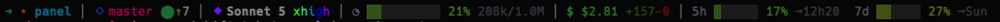

Mod do Claude Code que desenha, acima do prompt, uma linha colorida com diretório, git, modelo, uso de contexto, custo da sessão e rate limits.

## Instalação

No prompt do Claude Code:

```
/plugin install ccstatus --marketplace luizfbalves/ccstatus
```

Responder `y` para adicionar o marketplace e escolher o escopo (user). O mod passa a rodar na hora, sem reiniciar.

Fora de uma sessão:

```bash
claude plugin install ccstatus --marketplace luizfbalves/ccstatus
```

### Migrando da versão em bash

A versão antiga era um `statusLine` em `~/.claude/settings.json` apontando para `~/.claude/ccstatus.sh`. Depois de instalar o mod, remover a chave `statusLine` do settings.json (fazendo merge, sem sobrescrever o arquivo) e apagar `~/.claude/ccstatus.sh`, senão as duas linhas aparecem juntas.

## De onde vem cada dado

| Seção | Fonte |
|---|---|
| diretório | `$.session.cwd()` (basename) |
| git | `git status --porcelain=v2 --branch` via `$.process.run` |
| modelo | `$.session.model()`, formatado de id para nome (`claude-opus-5-5` → `Opus 5.5`) |
| effort | `effort` do último `turn.step` do loop principal |
| contexto | `$.session.usage().context` |
| custo | `$.session.usage().cost.usd` |
| rate limits 5h / 7d | `$.session.usage().rateLimits` |

A linha é recalculada em `session.start`, em cada `session.measure` (contexto, custo ou rate limit mudou) e ao fim de cada turno do loop principal.

Em relação à versão bash, ficaram de fora o badge `fast` e o diff `+N-N` de linhas da sessão: a API de mods não expõe esses dois números.

## Estrutura

- `.claude-plugin/plugin.json` / `marketplace.json`: manifesto e marketplace de um plugin só
- `hooks/register.tsx`: o módulo de hooks
- `types/index.d.ts`: contrato do `$.state` (`ccstatus.snapshot`)
- `tests/ccstatus.test.tsx`: testes do band (`claude plugin test .`)

Dentro de `register.tsx`:

- `pctColor(pct)`: gradiente contínuo verde `(21,128,61)` → âmbar `(180,131,15)` → vermelho `(185,28,28)`; também colore o custo, com `COST_CEILING_USD` ($30) equivalendo a 100%
- `bar(pct, largura)`: barra `▓`/`░` (10 colunas para contexto, 6 para rate limits)
- `fmtTokens(n)`: `50000` → `50k`, `1500000` → `1.5M`
- `refresh($)`: monta o `Snapshot` e grava no atom; o hook `ui.render` de `AbovePrompt` só lê o atom e desenha
- A paleta usa tons médio-saturados (estilo "600" do Tailwind) para manter contraste em tema claro e escuro

Para adicionar uma seção: incluir o campo em `Snapshot` (`types/index.d.ts`), preenchê-lo em `refresh` e dar `parts.push(...)` no render.

## Desenvolvimento

```bash
claude plugin validate .
claude plugin test .
claude --plugin-dir .   # sessão com o mod carregado da pasta
```

## Preview



```
orulpro │ main *3 │ Sonnet 5 high │ ctx ▓▓▓▓▓▓░░░░ 55% 550k/1.0M │ $1.95 │ 5h ▓▓▓░░░ 55% 12h33  7d ▓▓░░░░ 26% Sun
```

`*N` após a branch = arquivos modificados; `↑N`/`↓N` = commits à frente/atrás do upstream.
